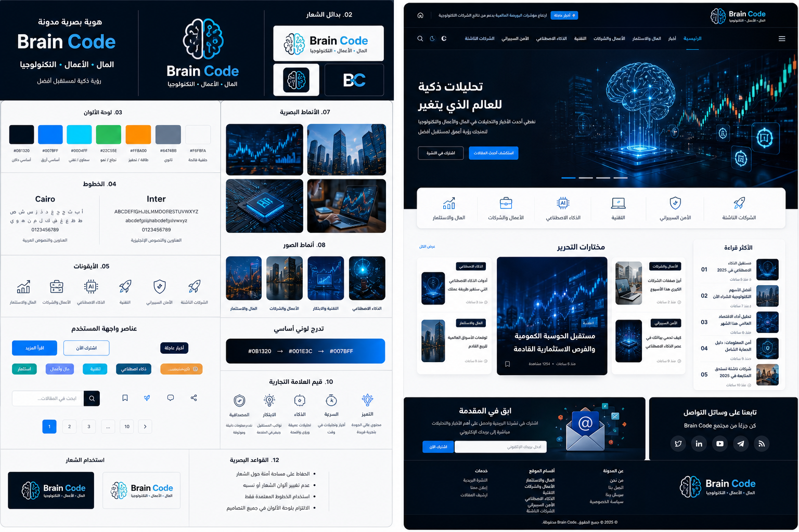

# Brain Code — دليل الهوية البصرية والتحريرية

**الإصدار:** 1.0  
**المنصة المستهدفة:** Blogger  
**مجالات المحتوى:** المال والاستثمار، الأعمال والشركات، التكنولوجيا، الذكاء الاصطناعي، الأمن السيبراني، الشركات الناشئة  
**اللغات المستهدفة:** العربية والإنجليزية، مع قابلية التوسع إلى لغات أخرى  
**اتجاه التصميم:** FinTech Editorial × FutureTech

> هذا الملف هو المرجع المعتمد للهوية البصرية وتجربة الاستخدام. عند تعارض أي نص توضيحي داخل الصورة المرجعية مع القيم المكتوبة هنا، تُعتمد القيم المكتوبة في هذا الدليل.

## 1. لوحة الهوية البصرية



الصورة أعلاه لوحة مرجعية لتوجيه التصميم وليست قالب Blogger جاهزاً للتثبيت. يجب تنفيذ الشعار والأيقونات والواجهات النهائية كعناصر مستقلة قابلة للتحرير، لا استخدام لقطة اللوحة كاملة كصورة للموقع.

## 2. جوهر العلامة التجارية

### اسم العلامة

**Brain Code**

### الوصف المختصر

منصة تحريرية رقمية تفسّر المال والأعمال والتكنولوجيا بوضوح، وتربط الأخبار بالتأثيرات العملية على الأفراد والشركات والأسواق.

### الشعار اللفظي المقترح

**المال • الأعمال • التكنولوجيا**

عبارة تحريرية بديلة للاستخدام في الحملات أو قسم المقدمة:

**رؤية ذكية لمستقبل أفضل.**

بالإنجليزية:

**Money • Business • Technology**  
**Clear insight into what comes next.**

### التموضع

Brain Code ليست مدونة تقنية خالصة، ولا نشرة مالية بحتة. إنها مجلة رقمية تجمع التحليل الاقتصادي، وقرارات الأعمال، والابتكار التقني في تجربة تحريرية حديثة ومتوازنة.

### شخصية العلامة

- **ذكية:** تشرح الجديد وتضعه في سياقه بدلاً من الاكتفاء بالعناوين.
- **موثوقة:** تميّز بين الخبر والتحليل والرأي، وتوضح مصادر المعلومات.
- **عصرية:** تستخدم صوراً تقنية قوية وتفاصيل بصرية دقيقة، دون زينة مشتتة.
- **واضحة:** تمنح النص والعناوين أولوية على المؤثرات.
- **متوازنة:** تبدو مناسبة للقارئ المهتم بالاستثمار وللقارئ المهتم بالذكاء الاصطناعي في الوقت نفسه.

### الجمهور الأساسي

القراء المهتمون بالاقتصاد والأسواق وريادة الأعمال، والعاملون في التكنولوجيا، والمهتمون بالذكاء الاصطناعي والشركات الناشئة والتحولات الرقمية.

## 3. المفهوم الإبداعي

### الاتجاه المعتمد: FinTech Editorial × FutureTech

- اعتماد **بنية تحريرية فاتحة** للمقالات والبطاقات، لتحقيق الراحة في القراءة الطويلة.
- استخدام **الكحلي العميق** في الترويسة والواجهة الرئيسية والفوتر، لبناء إحساس بالعمق والثقة.
- استخدام **الأزرق الكهربائي والسماوي** لتحديد الروابط والعناصر التفاعلية والإشارات التقنية.
- إدخال الأخضر في بيانات الأسواق الإيجابية أو المحتوى المالي عند الحاجة، لا كزينة عامة.
- استخدام الصور المستقبلية داخل مواضع محددة فقط، مع بقاء الصفحة مقروءة ومنظمة.

### المبدأ الحاكم

**التقنية تمنح Brain Code تميّزها، والتحرير الواضح يمنحها الثقة.** لا ينبغي أن تطغى المؤثرات أو الخلفيات الداكنة على المحتوى.

## 4. لوحة الألوان الرسمية

| الاسم | القيمة | الدور |
|---|---|---|
| Brain Navy | `#081320` | الترويسة الداكنة، الفوتر، الخلفيات الرئيسية الداكنة |
| Deep Navy | `#0B1E32` | البطاقات الداكنة والأسطح الثانوية |
| Electric Blue | `#007BFF` | الروابط والأزرار الرئيسية والحالة النشطة |
| Signal Cyan | `#00D4FF` | اللمسات التقنية والتوهج المحدود والرسوم الرقمية |
| Paper White | `#F6F8FA` | خلفية المقالات والصفحات الرئيسية الفاتحة |
| Pure White | `#FFFFFF` | البطاقات ومساحات القراءة |
| Slate | `#64748B` | النصوص الثانوية والبيانات الوصفية |
| Ink | `#142033` | النصوص الأساسية فوق الخلفيات الفاتحة |
| Market Green | `#22C55E` | مؤشرات إيجابية أو تصنيفات المال عند الحاجة |
| Alert Amber | `#FF8A00` | الأخبار العاجلة أو التنبيهات المحدودة |
| Border Gray | `#E2E8F0` | الحدود والفواصل الهادئة |

### قواعد استعمال اللون

1. يجب أن تكون الخلفية الافتراضية لمتن المقال `#F6F8FA` أو الأبيض.
2. يُستخدم `#081320` للهوية الداكنة والمناطق ذات الطابع التحريري القوي، لا لخلفية كل فقرة.
3. يُخصّص الأزرق للأفعال الأساسية والروابط المهمة. لا تجعل كل عنصر في الصفحة أزرق.
4. يُستخدم السماوي بنسبة محدودة، خصوصاً في التوهج والأيقونات والخطوط الدقيقة.
5. لا يُستخدم الأخضر أو البرتقالي وحده لتوصيل معنى مالي أو تحذيري؛ أضف نصاً أو رمزاً واضحاً.
6. يجب اختبار التباين الفعلي للنصوص والأزرار قبل النشر. لا تفترض أن اللون مناسب لمجرد أنه يبدو جيداً في لوحة التصميم.

### تدرج العلامة المعتمد

```css
:root {
  --bc-navy: #081320;
  --bc-navy-deep: #0B1E32;
  --bc-blue: #007BFF;
  --bc-cyan: #00D4FF;
  --bc-paper: #F6F8FA;
  --bc-white: #FFFFFF;
  --bc-ink: #142033;
  --bc-slate: #64748B;
  --bc-green: #22C55E;
  --bc-amber: #FF8A00;
  --bc-border: #E2E8F0;

  --bc-gradient-brand: linear-gradient(
    115deg,
    #081320 0%,
    #0B1E32 42%,
    #007BFF 100%
  );
}
```

> هذه القيم مرجع للتنفيذ وليست مطالبة باستخدام جميع الألوان في كل صفحة. يجب تحويلها إلى متغيرات CSS في القالب لتسهيل صيانة الهوية.

## 5. الشعار ونظامه

### الفكرة الأساسية

رمز دماغ مبسّط ينقسم بصرياً إلى جانب عضوي وجانب رقمي، مع نقاط اتصال أو مسارات دوائر إلكترونية قليلة. يوحي الرمز بالتفكير والتحليل والشفرة من دون استخدام تفاصيل دقيقة تضيع عند التصغير.

### تركيب الشعار

- الرمز: دماغ هندسي مبسّط بخطوط واضحة.
- الاسم: `Brain Code` مكتوب بخط لاتيني هندسي واضح.
- تمييز الاسم: `Brain` بلون أبيض أو Ink و`Code` بالأزرق، بحسب الخلفية.
- السطر التعريفي الاختياري: `المال • الأعمال • التكنولوجيا`.

### النسخ المطلوب توفيرها عند التنفيذ

1. **النسخة الرئيسية الأفقية:** الرمز بجانب اسم Brain Code.
2. **نسخة الخلفية الداكنة:** اسم فاتح و`Code` بالأزرق/السماوي.
3. **نسخة الخلفية الفاتحة:** اسم داكن و`Code` بالأزرق.
4. **رمز مستقل:** الدماغ الرقمي لاستخدامه كأيقونة موقع وصورة حساب.
5. **نسخة أحادية اللون:** للطباعة أو الحالات التي لا تدعم اللون.

### ضوابط الشعار

- لا تمدد الشعار أو تغيّر النسب بين الرمز والنص.
- لا تستخدم التوهج أو الظلال الثقيلة كجزء أساسي من الشعار.
- اترك مساحة خالية حوله لا تقل عن ارتفاع الحرف `B` في كلمة Brain.
- يجب أن يظل مقروءاً في مساحة صغيرة؛ تجنّب وضع السطر التعريفي في نسخة الهاتف أو الأيقونة.
- يُفضّل إنشاء نسخة SVG نظيفة مع ملف PNG احتياطي. لا تعتمد على الصورة المرجعية بوصفها ملف الشعار النهائي.

## 6. الخطوط والطباعة

### التوليفة الأساسية

- **العربية:** Cairo للعناوين وواجهات الاستخدام، مع اختبار `Noto Sans Arabic` كبديل عند الحاجة إلى دعم أوسع للأوزان والأنظمة.
- **الإنجليزية والأرقام اللاتينية:** Inter.
- **البدائل العامة:** `system-ui`, `sans-serif`.

### الأوزان المقترحة

| الاستخدام | الوزن | ملاحظات |
|---|---:|---|
| عنوان الواجهة الرئيسي | 700–800 | سطران كحد مفضّل على الهاتف |
| عنوان المقال | 700–800 | واضح دون ضغط الحروف أو زخرفة |
| عناوين الأقسام | 700 | ثابتة عبر جميع الصفحات |
| نص المقال | 400–500 | مريح للقراءة الطويلة |
| بيانات المقال | 400–500 | أصغر من المتن لكن مقروءة |
| الأزرار والتنقل | 600 | تسميات قصيرة ومباشرة |

### أحجام استرشادية

- عنوان الواجهة على سطح المكتب: `clamp(2rem, 4vw, 3.5rem)`.
- عنوان المقال: `clamp(2rem, 4vw, 3rem)`.
- عنوان القسم: `1.35rem–1.75rem`.
- متن المقال: `1.0625rem–1.1875rem`.
- ارتفاع السطر للمتن العربي: `1.8–2.0`.
- طول السطر المثالي للمقال: نحو 60–80 محرفاً تقريباً، مع السماح بتغيره بحسب الخط والجهاز.

### قواعد الطباعة

- لا تستخدم أكثر من عائلتين أساسيتين للخطوط دون مبرر واضح.
- لا تجعل النصوص الثانوية رمادية فاتحة جداً.
- تجنّب الفقرات الطويلة بعرض الشاشة بالكامل.
- استخدم تباعداً واضحاً بين العنوان والمقدمة والمتن.
- اختبر التشكيل والأرقام والروابط والاختلاط بين العربية والإنجليزية.
- قلّل تحميل أوزان الخطوط الخارجية؛ استخدم أوزاناً محدودة واحتياطياً نظامياً لتحسين سرعة العرض.

## 7. نظام الأيقونات والرسوم

- استخدم مجموعة خطية متناسقة مثل Lucide، أو مجموعة SVG مخصصة بنفس سماكة الخط.
- اعتمد أيقونات بسيطة قابلة للفهم بحجم 20–24 بكسل في الواجهة.
- لا تخلط الأيقونات ثلاثية الأبعاد مع الأيقونات الخطية في الصف نفسه.
- يجب أن تملك الأيقونات التفاعلية تسمية نصية أو اسماً متاحاً لقارئات الشاشة.
- لا تستخدم الرموز التعبيرية بديلاً عن الأيقونات الأساسية في التنقل.

## 8. أسلوب الصور والتحرير البصري

### التوجه العام

صور تحريرية نظيفة، ذات طابع واقعي أو سينمائي محسوب، مع إضاءة باردة ولمسات زرقاء. يجب أن تتصل الصورة فعلياً بموضوع المقال لا أن تكون مجرد زخرفة تقنية.

### توجيهات حسب التصنيف

- **المال والأسواق:** رسوم سوق واضحة، مبانٍ مالية، تحليل بيانات، وألوان هادئة. لا تعرض مؤشرات رقمية مولّدة على أنها بيانات حقيقية.
- **الأعمال والشركات:** فرق عمل، مكاتب، مصانع، مؤتمرات، ومدن أعمال.
- **الذكاء الاصطناعي:** صور تقنية مستقبلية مضبوطة، مع تجنب صور الروبوتات النمطية المتكررة.
- **التكنولوجيا:** أجهزة وشرائح ومعالجات ومختبرات وصور منتجات دقيقة.
- **الأمن السيبراني:** شبكات وأقفال وواجهات أمنية مجردة؛ لا تعرض تفاصيل تقنية مضللة كأنها لقطات حقيقية.
- **الشركات الناشئة:** مؤسسون ومنتجات وبيئات عمل واقعية.

### قواعد الصور

- صورة رئيسية واحدة قوية لكل مقال.
- نسبة `16:9` لصورة المقال الرئيسية، مع قصّ بديل للبطاقات الصغيرة.
- لا تضع نصاً ضرورياً داخل الصورة؛ اكتب العنوان في HTML ليبقى قابلاً للفهرسة والوصول.
- ضغط الصور واستخدام صيغ حديثة عند توفرها، وتحديد `width` و`height` أو نسبة أبعاد ثابتة.
- استخدم `loading="lazy"` للصور خارج الشاشة الأولى فقط، وتجنب تأخير صورة LCP الرئيسية بلا داعٍ.
- لا تعرض رسوم الأسهم أو أسعار العملات المولّدة بصرياً على أنها بيانات مالية حية.

## 9. بنية الموقع وتجربة الاستخدام

### الترويسة

- شريط علوي اختياري للأخبار العاجلة أو رسالة تحريرية قصيرة.
- شعار Brain Code واضح، دون ازدحام.
- قائمة رئيسية: الرئيسية، المال والاستثمار، الأعمال والشركات، التكنولوجيا، الذكاء الاصطناعي، الأمن السيبراني، الشركات الناشئة.
- زر بحث واضح وقابل للاستخدام بلوحة المفاتيح.
- مفتاح لغة ظاهر عند توفر نسخة مترجمة مقابلة فعلياً.
- قائمة هاتف بسيطة لا تغطي المحتوى دون وسيلة واضحة للإغلاق.

### قسم الواجهة الرئيسية

- مساحة افتتاحية تجمع عنواناً تحريرياً واحداً وصورة رئيسية قوية.
- عنوان قصير يوضح قيمة المدونة، لا عبارة تسويقية عامة فقط.
- زر أساسي مثل «استكشف أحدث المقالات».
- تجنّب الدوران التلقائي السريع للشرائح؛ يفضّل مقال مميز ثابت أو انتقال يدوي.

### الصفحة الرئيسية

الترتيب المقترح:

1. الترويسة والتنقل.
2. المقال الرئيسي أو أهم خبر.
3. اختصارات التصنيفات.
4. مختارات التحرير.
5. آخر أخبار التكنولوجيا والذكاء الاصطناعي.
6. المال والاستثمار والأعمال.
7. الشركات الناشئة والأمن السيبراني.
8. الأكثر قراءة، إذا كانت البيانات متاحة بصورة موثوقة.
9. الاشتراك في النشرة البريدية إن كانت هناك خدمة فعلية.
10. الفوتر.

### بطاقات المقالات

يجب أن تتضمن عند توفر البيانات:

- صورة ذات أبعاد ثابتة.
- تصنيفاً واضحاً.
- عنواناً يصف محتوى المقال بدقة.
- مقتطفاً قصيراً اختيارياً.
- تاريخ النشر أو التحديث بشكل صحيح.
- اسم الكاتب عندما يكون متاحاً.
- رابطاً واضحاً إلى المقال.

لا تكرر معلومات كثيرة على كل بطاقة، ولا تضع كل البطاقات بحجم واحد إذا كان ذلك يضعف التسلسل البصري.

### صفحة المقال

- مسار تنقل Breadcrumb واضح.
- تصنيف وعنوان وملخص تحريري وصورة رئيسية.
- اسم الكاتب وتاريخ النشر وتاريخ التحديث فقط إذا كان صحيحاً.
- عرض مريح للمتن، وروابط داخلية ذات صلة.
- محتويات المقال عند الحاجة للمقالات الطويلة.
- إسناد المصادر في المقالات المالية والتقنية الحساسة أو الإخبارية.
- أزرار مشاركة غير مزعجة.
- مقالات ذات صلة مبنية على موضوع حقيقي، لا مجرد تكرار عشوائي.
- بيانات Article/BlogPosting المنظمة عند انطباقها.

### صفحات أخرى

- صفحة التصنيف/الأرشيف: عنوان ووصف موجز وشبكة مقالات قابلة للتصفح.
- البحث: نتائج قابلة للفهم مع حالة واضحة عند عدم العثور على نتائج.
- من نحن: رسالة تحريرية ومعلومات دقيقة عن المشروع.
- التواصل: وسيلة تواصل حقيقية، وسياسة الخصوصية، وإخلاء المسؤولية عند الحاجة.
- صفحة الخطأ: مساعدة المستخدم على العودة إلى الرئيسية أو البحث.

### الفوتر

يتضمن الشعار، وصفاً قصيراً، روابط التصنيفات الرئيسية، صفحة من نحن، التواصل، الخصوصية، وإخلاء المسؤولية المالي عند نشر محتوى قد يُفهم كنصيحة استثمارية. لا تضف روابط اجتماعية أو نموذج نشرة بريدية لا تعمل فعلياً.

## 10. تصنيفات المحتوى وألوانها

الألوان التالية علامات مساعدة للتصنيف وليست بدائل عن كتابة اسم التصنيف نصياً.

| التصنيف | اللون المساعد | رمز مقترح |
|---|---|---|
| المال والاستثمار | `#22C55E` | مخطط نمو |
| الأعمال والشركات | `#007BFF` | حقيبة أعمال |
| التكنولوجيا | `#00A9E8` | شريحة/جهاز |
| الذكاء الاصطناعي | `#00D4FF` | شبكة عصبية مبسطة |
| الأمن السيبراني | `#6474FF` | درع |
| الشركات الناشئة | `#FF8A00` | صاروخ أو شرارة |

استخدم الرموز نفسها وألوانها في الوسوم والبطاقات، مع الحفاظ على التباين وعدم الاعتماد على اللون وحده لنقل المعنى.

## 11. نظام المكونات

يجب تصميم الأنماط التالية مرة واحدة وإعادة استخدامها:

- زر أساسي أزرق وزر ثانوي بإطار واضح.
- رابط نصي مع حالة Hover وFocus مميزة.
- شارة تصنيف.
- بطاقة مقال عادية وبطاقة رئيسية.
- قائمة تنقل لسطح المكتب والهاتف.
- حقل بحث وحالة فارغة.
- ترقيم الصفحات.
- كتلة اقتباس وصندوق ملاحظة تحريري.
- قائمة مقالات ذات صلة.
- تنبيه أخبار عاجلة دون وميض أو حركة متكررة.

### قواعد التفاعل

- إظهار مؤشر التركيز عند التنقل بلوحة المفاتيح.
- توفير مساحة لمس مناسبة للأزرار والروابط على الهاتف.
- احترام تفضيل تقليل الحركة عبر `prefers-reduced-motion`.
- تجنب الاعتماد على Hover وحده لإظهار وظيفة.
- تجنب الظلال والانتقالات الطويلة والوهج الزائد.
- يجب أن تكون كل وظيفة مرئية قابلة للاستخدام على الهاتف ولوحة المفاتيح.

## 12. الحركة والمؤثرات

الطابع المطلوب فاخر وخفيف، وليس استعراضياً.

- انتقالات قصيرة تقريباً `150–220ms` للعناصر الصغيرة.
- ظهور خفيف للبطاقات عند الحاجة، من دون فرض حركة على كل عنصر.
- توهج سماوي محدود في عناصر الهوية أو التفاعلات المهمة.
- لا تشغّل فيديو خلفية أو رسوم Canvas ثقيلة في الواجهة الرئيسية بلا حاجة واضحة.
- تعطيل الحركة الزخرفية عند تفعيل تقليل الحركة.

## 13. تعدد اللغات وRTL/LTR

### المتطلبات

- دعم العربية بـ`dir="rtl"` والإنجليزية بـ`dir="ltr"` على مستوى الصفحة.
- ضبط `lang` بشكل صحيح لكل نسخة.
- استخدام خصائص CSS المنطقية مثل `margin-inline-start` بدلاً من الاعتماد المفرط على `margin-left` و`margin-right`.
- مراجعة ترتيب الأيقونات والأسهم ومسارات التنقل والقوائم في الاتجاهين.
- اختبار الأرقام والعملات والتواريخ والنصوص المختلطة عربي/إنجليزي.
- مفتاح اللغة يجب أن ينقل إلى النسخة المقابلة لنفس المقال أو الصفحة عندما تكون موجودة؛ لا يوجّه كل الصفحات إلى الرئيسية دون توضيح.

### ملاحظة SEO متعددة اللغات

ينبغي أن تكون لكل نسخة لغوية صفحة قابلة للوصول بعنوان URL واضح، مع Canonical صحيح وإشارات `hreflang` عند انطباقها. لا تفترض أن Blogger يربط الترجمات تلقائياً؛ يجب إدارة علاقة النسخ المترجمة ضمن آلية تحريرية أو بيانات مخصصة واختبارها.

## 14. قواعد SEO والأداء

### SEO على مستوى القالب

- عنوان صفحة فريد ومناسب لنوع الصفحة.
- وصف ميتا مفيد وغير مكرر قدر الإمكان.
- Canonical لا يشير إلى صفحة مختلفة بالخطأ.
- تسلسل عناوين دلالي واضح.
- روابط داخلية وصفحات تصنيف قابلة للزحف.
- نصوص بديلة للصور عند الحاجة.
- بيانات Open Graph صحيحة للمشاركة.
- بيانات منظمة مناسبة للمقال ومسار التنقل عند انطباقها.
- عدم توليد بيانات مراجعات أو تقييمات أو أسعار غير حقيقية.
- عدم حشو الكلمات المفتاحية أو تكرار عناوين مخفية.
- مراجعة Sitemap وRobots في Blogger وعدم إنشاء قواعد متضاربة.

### أهداف أداء داخلية

هذه أهداف للقياس وليست ضمانات:

- استهداف قيم Core Web Vitals الجيدة ميدانياً: LCP لا يتجاوز 2.5 ثانية، وINP لا يتجاوز 200ms، وCLS لا يتجاوز 0.1، وفق الشروط المعتادة للقياس عند الشريحة المئوية 75.
- تقليل JavaScript المخصص إلى الحد الضروري.
- عدم تحميل مكتبة واجهات ضخمة لمجرد استخدام مكوّن واحد.
- تحميل صور خارج الشاشة عند الحاجة فقط.
- إعطاء أولوية تحميل مناسبة لصورة الواجهة الرئيسية عندما تكون عنصر LCP.
- تحديد أبعاد الصور والمساحات المحجوزة لتقليل تغير التخطيط.
- اختبار الهاتف الحقيقي، وليس الاعتماد على معاينة سطح المكتب وحدها.

### الأداء لا يُضمن بالهوية

الألوان أو التصميم الداكن أو الفاتح لا تحدد السرعة بذاتها. السرعة النهائية تعتمد على الصور، والخطوط، والشيفرات، والودجات والإعلانات، وأسلوب عرض المحتوى.

## 15. متطلبات خاصة بمنصة Blogger

- التسليم النهائي الأساسي هو **قالب XML صالح لـBlogger**.
- احترام وسوم Blogger مثل `b:section` و`b:widget` و`b:if` و`b:loop` وبيانات الصفحة المتاحة.
- اختبار القالب في مدونة تجريبية قبل استبدال القالب المنشور.
- التحقق من عرض الصفحة الرئيسية والمقال والتصنيف والأرشيف والبحث وصفحات Blogger الثابتة.
- عدم اعتبار معاينة HTML محلية دليلاً كافياً على توافق القالب؛ بعض البيانات لا تظهر إلا داخل Blogger.
- إبقاء التخصيصات قابلة للصيانة باستخدام متغيرات CSS واضحة وأسماء دلالية.
- توفير حالات بديلة عند غياب صورة أو وصف أو تاريخ أو تصنيف.
- تجنب إضافة مكتبات خارجية أو تتبع إعلاني دون مبرر واضح.
- حفظ نسخة احتياطية من القالب قبل كل تحديث.

### قابلية التخصيص المطلوبة

يجب إعداد قيم يسهل تغييرها من مكان مركزي، بما في ذلك:

- ألوان العلامة والخلفيات والنصوص.
- الخطوط وأحجام العناوين.
- نصف أقطار الحواف والظلال والمسافات.
- عرض منطقة القراءة.
- إظهار وإخفاء الأقسام الرئيسية عند الإمكان.
- ترتيب التصنيفات وعناصر القائمة.
- الوضع الفاتح والداكن إذا نُفّذ الوضع الداكن بصورة كاملة ومختبرة.

لا ينبغي الادعاء بأن كل عنصر قابل للتعديل من لوحة Blogger ما لم يُربط فعلياً بإعداد أو عنصر قابل للتحرير.

## 16. متطلبات تسليم الأصول

عند تنفيذ الهوية في ملفات فعلية، يفضّل توفير:

- شعار رئيسي SVG.
- شعار أحادي اللون SVG.
- رمز مستقل SVG وPNG.
- صورة Open Graph رئيسية بمقاس مناسب.
- أيقونة موقع Favicon.
- ألوان وخطوط على هيئة CSS variables.
- دليل استخدام الشعار والألوان.
- قالب Blogger XML.
- ملف README يشرح طريقة التثبيت والاستعادة والتخصيص.
- سجل بالتغييرات والإصدارات.

## 17. قائمة الفحص قبل الإطلاق

### الهوية

- [ ] الاسم مكتوب دائماً `Brain Code` دون اختلاف غير مقصود.
- [ ] استعمال نسخ الشعار المناسبة للخلفية الفاتحة والداكنة.
- [ ] توحيد لوحة الألوان والأيقونات والخطوط.
- [ ] عدم استخدام صورة لوحة الهوية مكان العناصر المنفصلة.

### الاستخدام والتجاوب

- [ ] اختبار العرض على هاتف صغير وهاتف كبير وجهاز لوحي وسطح مكتب.
- [ ] اختبار القائمة والبحث والروابط والترقيم.
- [ ] اختبار لوحة المفاتيح والتركيز وتقليل الحركة.
- [ ] اختبار RTL وLTR فعلياً.
- [ ] التحقق من تباين الألوان ووضوح النصوص.

### Blogger وSEO

- [ ] استيراد XML في مدونة تجريبية بنجاح.
- [ ] اختبار الصفحة الرئيسية وصفحات المقال والأرشيف والبحث.
- [ ] فحص العناوين والوصف وCanonical ووسوم Robots.
- [ ] اختبار البيانات المنظمة والروابط وصور المشاركة.
- [ ] التحقق من مفتاح اللغة وروابط النسخ المقابلة.
- [ ] التأكد من أن جميع النماذج والأزرار تؤدي وظيفة فعلية.

### الأداء والأمان

- [ ] اختبار Lighthouse على عدة أنواع من الصفحات.
- [ ] اختبار الأداء على الهاتف واتصال أبطأ.
- [ ] ضغط الصور وتحديد الأبعاد ومراجعة الخطوط.
- [ ] إزالة JavaScript وCSS غير المستخدمين قدر الإمكان.
- [ ] فحص الاعتماديات والأسرار قبل نشر ملفات المصدر.
- [ ] حفظ نسخة احتياطية وخطة للرجوع عن الإصدار.

## 18. ملخص تنفيذي للمطوّر

أنشئ قالب Blogger مخصصاً لعلامة **Brain Code** باستخدام اتجاه **FinTech Editorial × FutureTech**: محتوى تحريري فاتح ومريح، وترويسة وفوتر كحليين، ولمسات زرقاء وسماوية دقيقة، وشعار دماغ رقمي بسيط، وخط Cairo للعربية وInter للإنجليزية مع بدائل نظامية. اجعل بنية الصفحة واضحة للمال والأعمال والتكنولوجيا، وادعم RTL/LTR، وطبّق SEO تقنياً دون بيانات مضللة، وقلّل JavaScript والصور الثقيلة، واختبر القالب داخل Blogger إضافة إلى اختبارات الأداء والوصول. اجعل كل عنصر قابل للتخصيص بقدر ما تسمح به المنصة، ووثّق بوضوح ما يمكن تعديله من لوحة Blogger وما يتطلب تعديل XML.

**المرجع البصري:** `brain-code-visual-identity-board.png`  
**ملف الهوية:** `brain-code-visual-identity.md`
